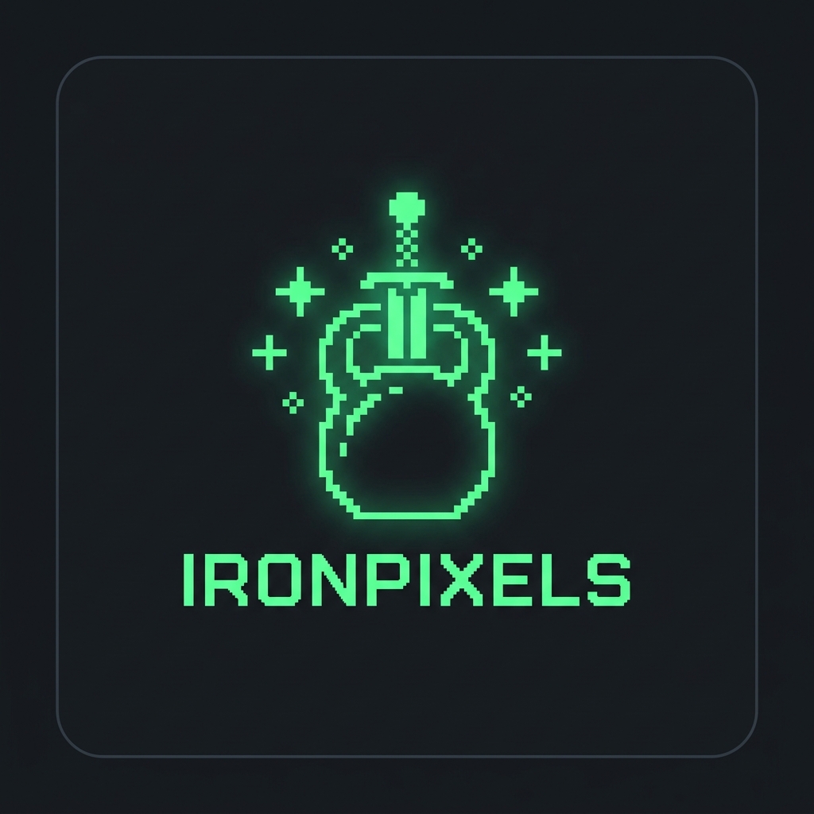
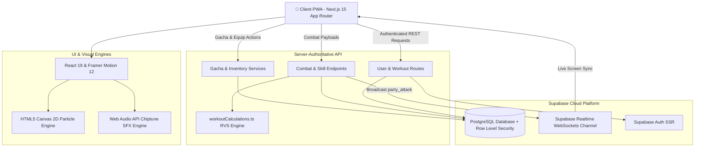

<p align="center">
  
</p>

<h1 align="center">⚔️ IronPixels</h1>

<p align="center">
  <strong>Level up your gym gains in retro 16-bit pixel RPG style.</strong><br />
  A Progressive Web Application (PWA) that transforms barbell sweat and gym volume into heroic dungeon progression.
</p>

<p align="center">
  <a href="https://iron-pixels.vercel.app">
    
  </a>
  <a href="https://nextjs.org/">
    
  </a>
  <a href="https://supabase.com/">
    
  </a>
  <a href="https://www.typescriptlang.org/">
    
  </a>
  <a href="https://tailwindcss.com/">
    
  </a>
  
</p>

---

## 📖 Overview

Conventional fitness tracking applications suffer from high churn because entering sets and reps quickly feels repetitive. **IronPixels** reinvents the gym routine by fusing weightlifting logs with classic retro MMORPG dungeon crawling.

- **Authoritative Relative Volume Score (RVS)**: Every repetition, set, and kilogram lifted is processed by a server-side algorithm that normalizes power based on bodyweight ratios and exercise movement tiers.
- **Pixel Art Retrogaming Aesthetic**: 100% crisp pixel rendering using the acclaimed **0x72 Dungeon Tileset II**, featuring gendered hero sprites, 27 dungeon weapons, animated mimic chests, and 18 diverse monster species.
- **Realtime Co-Op Guild Raids**: Battle alongside party members in real time through Supabase Realtime WebSockets, synchronizing floating damage numbers, sound effects, and boss HP bars across screens with zero database latency.
- **Gym-Grade Experience**: Features industry-standard utilities including previous session ghost values, single-click autofill, background-resilient rest timers, dynamic KG/LBS conversion, and routine presets.

🌐 **Production Deployment**: [https://iron-pixels.vercel.app](https://iron-pixels.vercel.app)

---

## 🏗️ System Architecture

IronPixels is built on a high-throughput, modern web architecture optimized for low latency, offline resilience, and fluid 60 FPS animation.



### Technology Stack & Rationale

| Layer | Technology | Engineering Rationale |
| :--- | :--- | :--- |
| **Framework** | **Next.js 15.5 (App Router)** | Hybrid rendering, optimized edge caching, secure Server Actions, and native PWA metadata compilation. |
| **Frontend UI** | **React 19 & TailwindCSS 3.4** | Modern reactive state management, CSS subpixel budgeting, and retro dark-mode design tokens. |
| **Animation & FX** | **Framer Motion 12 & Canvas 2D** | Fluid state transitions coupled with high-performance floating damage particle engines. |
| **Database & Auth** | **Supabase (PostgreSQL 15)** | Row Level Security (RLS), atomic Compare-And-Swap (CAS) functions, and relational integrity. |
| **Networking** | **Supabase Realtime WebSockets** | Zero-latency pub/sub broadcast channels for multi-device Co-Op boss raids. |
| **Type Safety** | **TypeScript 5.7 & Strict Typecheck** | End-to-end data safety across database models, calculation engines, and client interfaces. |
| **Testing** | **Node.js Native Test Suite + tsx** | Ultra-fast unit testing covering server RVS calculations and unit conversions. |

---

## 🎮 Core System Features

### 1. 🏋️ Gym Tracking (Industrial Standard)
- **Previous Session Ghost Values**: Input fields display faint ghost hints (`LAST: 60kg × 10`) extracted from previous workouts.
- **⚡ Single-Click Autofill**: Copies weights and repetitions from prior sessions with instant sound feedback.
- **Background-Resilient Rest Timer**: Powered by a timestamp target model (`Date.now() + durationMs`) and `visibilitychange` listeners, remaining accurate even when devices are locked or switched to music apps.
- **Dynamic KG / LBS Switching**: Real-time conversions across tracking forms and history lists with canonical database storage in kilograms.
- **Completed Sets Filtering**: Unchecked sets are excluded from RVS calculations with modal confirmation guards.
- **Workout Routine Presets**: Save, load, and manage favorite exercise templates with one click.

### 2. 🧮 Server-Authoritative RVS & Anti-Cheat Engine
- **Fair Scaling**: Damage relies on Relative Volume Score rather than raw weight, balancing athletes across diverse bodyweights:
  $$\text{RVS} = \left( \frac{\text{Weight (kg)}}{\text{Bodyweight (kg)}} \right) \times \text{Reps} \times \text{Movement Multiplier} \times \left( \frac{\text{Stat}}{50} \right)$$
- **Movement Multipliers**: Isolation exercises (e.g., Curls: `2.0×`) reward appropriate effort compared to heavy compounds (e.g., Squats: `1.0×`).
- **Single-Hit Damage Caps**: Inbound attack payloads enforce server-side validation caps (`MAX_SINGLE_HIT_DAMAGE = 50,000`) preventing unauthorized client injections.

### 3. ⚔️ Infinite Dungeons & Dual Combat Lobbies
- **Solo Dungeon**: Personal progression through infinite floors. Floors 1–4 spawn randomized mob enemies; every 5th floor features epic boss encounters.
- **Party Raid Lobby**: Multiplied monster HP pools designed for collaborative party battles with separate progression logs.
- **Tactical Gear Skills**: Equipment grants active combat skills with individual cooldown timers and visual casting animations.

### 4. 📡 Realtime Co-Op Guild Raids
- **WebSocket Broadcast**: Channel `party_raid:[party_id]` relays attacks live across party members without database roundtrip lag.
- **Live Canvas Particles**: Teammates see floating damage numbers tagged with attacker usernames (`[ALEX] HEAVY IRON SLASH -1,450`).
- **Synchronized Boss HP**: Simultaneous boss health depletion, hit flash animations, and victory loot distribution.

### 5. 💀 Death Penalty & Dual Revival System
- **0 HP Defeated State**: Taking lethal damage from missed-workout boss penalties (*Demon Lord Ignis*) or dungeon combat locks hero actions.
- **Free Gym Sweat Revival (Recommended)**: Completing one real gym workout resurrects the character with **100% Max HP**.
- **Instant Revive Potion**: Available at the Blacksmith shrine for 500 Dungeon Gold via atomic CAS verification.

### 6. 💰 Economy, Blacksmith & Inventory
- **Atomic Gacha Chests**: Compare-And-Swap transactional chest opening for Regular and Void Chests preventing duplicate exploits.
- **Equipment Inventory**: Equip weapons, armor, and dual accessory slots; sell surplus gear for Gold.

---

## 🗄️ Database Schema & DDL Highlights

```sql
-- Profiles: Hero attributes, level, and preferences
CREATE TABLE public.profiles (
    id UUID PRIMARY KEY REFERENCES auth.users(id) ON DELETE CASCADE,
    username TEXT NOT NULL,
    character_class TEXT DEFAULT 'WARRIOR',
    gender TEXT DEFAULT 'm',
    level INT DEFAULT 1,
    current_hp INT DEFAULT 1000,
    max_hp INT DEFAULT 1000,
    exp INT DEFAULT 0,
    max_exp INT DEFAULT 1000,
    gold INT DEFAULT 500,
    weight_kg NUMERIC DEFAULT 75,
    weight_unit TEXT DEFAULT 'kg',
    available_ap INT DEFAULT 5,
    str INT DEFAULT 85,
    agi INT DEFAULT 70,
    vit INT DEFAULT 60,
    luk INT DEFAULT 50,
    updated_at TIMESTAMPTZ DEFAULT NOW()
);

-- Workout Sessions: Verified gym logs
CREATE TABLE public.workout_sessions (
    session_id UUID PRIMARY KEY DEFAULT gen_random_uuid(),
    user_id UUID NOT NULL REFERENCES auth.users(id) ON DELETE CASCADE,
    workout_name TEXT NOT NULL,
    total_volume_kg NUMERIC NOT NULL,
    total_rvs NUMERIC NOT NULL,
    exercises_log JSONB NOT NULL,
    created_at TIMESTAMPTZ DEFAULT NOW()
);

-- Dungeon Bosses: Boss health & stage state
CREATE TABLE public.dungeon_bosses (
    boss_id TEXT PRIMARY KEY,
    boss_name TEXT NOT NULL,
    stage INT NOT NULL,
    current_hp NUMERIC NOT NULL,
    max_hp NUMERIC NOT NULL,
    status TEXT DEFAULT 'Active',
    category TEXT DEFAULT 'mob',
    mode TEXT DEFAULT 'solo',
    sprite_config JSONB,
    updated_at TIMESTAMPTZ DEFAULT NOW()
);
```

---

## 🚀 Local Development Setup

### Prerequisites
- **Node.js**: v20.x or v24.x
- **Package Manager**: npm or pnpm
- **Supabase Account**: A Supabase project with PostgreSQL enabled

### 1. Clone & Install
```bash
git clone https://github.com/felixpalingan/IronPixels.git
cd IronPixels
npm install
```

### 2. Configure Environment Variables
Create a `.env.local` file in the root directory:
```env
NEXT_PUBLIC_SUPABASE_URL=https://your-project.supabase.co
NEXT_PUBLIC_SUPABASE_ANON_KEY=your-anon-key
SUPABASE_SERVICE_ROLE_KEY=your-service-role-key
CRON_SECRET=your-secure-cron-secret
```

### 3. Run Automated Tests
Execute the built-in mathematical engine test suite:
```bash
npm test
```

### 4. Start Development Server
```bash
npm run dev
```
Open [http://localhost:3000](http://localhost:3000) in your browser.

---

## 🧪 Quality Assurance & Build Verification

The application maintains zero-warning production compilation:
- **Build**: `npm run build` generates optimized static pages and standalone PWA artifacts.
- **Unit Testing**: Tests cover authoritative RVS calculation bounds, completed set filtering, and precision metric conversion.

---

## 📜 Author & License

- **Author**: Felix Palingan ([@felixpalingan](https://github.com/felixpalingan))
- **Assets**: 0x72 Dungeon Tileset II v1.7 (Art by 0x72, used under CC0 / public domain licensing).
- **License**: MIT License. See [LICENSE](LICENSE) for details.
